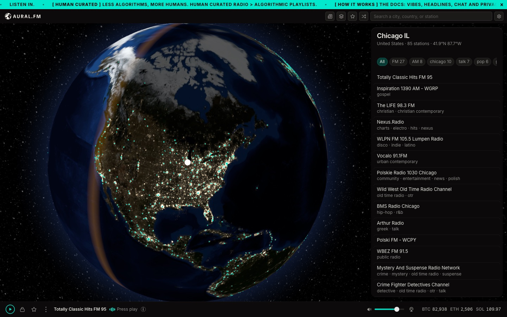

# AuralFM



## Introduction

**Listen in.** A globe you listen to: 60,000 live radio stations, placed where
they broadcast and played from each station's own server.

- **Web and iPhone:** [listen.auralfm.xyz](https://listen.auralfm.xyz). On an
  iPhone, add it to the Home Screen.
- **Mac:** in beta. Build it from this repo (below).
- **About the project:** [auralfm.xyz](https://auralfm.xyz) ·
  **Docs:** [docs.auralfm.xyz](https://docs.auralfm.xyz)

## What it does

- **Stations on a globe.** Pick a town, hear what is on there. No ranking, no
  promoted slots.
- **Shortwave.** Tune receivers that volunteers run around the world.
- **A room for every town.** Chat with people listening to the same place, over
  [Nostr](https://nostr.com) relays. Mute, filter and report are built in.
- **Favorites that follow you.** Sync between devices with a code.
- **Your show (beta).** Go live from your town, device to device.

## Run it

Needs macOS and [Node.js](https://nodejs.org) 18 or later.

```bash
git clone https://github.com/AuralFM/auralfm.git
git clone https://github.com/AuralFM/catalogue.git auralfm-catalogue   # the station list, beside the app
cd auralfm
npm install
npm run catalogue   # take the list and its code from ../auralfm-catalogue
npm start
```

| Command | What it does |
|---|---|
| `npm start` | Run the Mac app |
| `npm run audit` | The test suite. Run it before every commit |
| `npm run web` | Build the web player into `dist-web/` |
| `npm run web:serve` | Serve that build at `localhost:8765` |
| `npm run catalogue` | Take the station list and its code from `../auralfm-catalogue` |
| `npm run dist` | Build the Mac DMGs (unsigned for now) |

## Where things are

| Folder | What |
|---|---|
| `src/` | The app: main process, and the pages in `src/renderer/` |
| `web/` | What the web player adds on top of the app's pages |
| `data/` | The catalogue, the shortwave schedule and the relay list |
| `scripts/` | Builds, the catalogue pipeline and the audit |
| `docs/` | How it is built, and the public documents. Start at [docs/README.md](docs/README.md) |

## Project resources

| Resource | What |
|---|---|
| [How it is built](docs/ARCHITECTURE.md) | One set of pages, run two ways |
| [CONTRIBUTING.md](CONTRIBUTING.md) | How to build, test and send a change |
| [GOVERNANCE.md](GOVERNANCE.md) | How decisions are made |
| [CODEOWNERS](CODEOWNERS) | Who reviews changes |
| [SECURITY.md](SECURITY.md) | How to report a security problem |
| [Code of Conduct](CODE_OF_CONDUCT.md) | For working on the project. The app's rooms have [their own rules](docs/CODE-OF-CONDUCT.md) |
| [Privacy](docs/PRIVACY.md) · [Terms](docs/TERMS.md) | What the app does with data, and the terms of use |
| [For stations](docs/STATIONS.md) | Correct, remove or claim a station |
| [LICENSE](LICENSE) · [NOTICE](NOTICE) | Apache 2.0 |

## Credits

Stations from [radio-browser.info](https://www.radio-browser.info) and the
stations themselves. Places from [GeoNames](https://www.geonames.org) (CC BY 4.0).
Receivers from the [KiwiSDR](http://kiwisdr.com) community. Imagery from
[NASA GIBS](https://nasa-gibs.github.io/gibs-api-docs/). Every library and its
licence is in [THIRD-PARTY-NOTICES.md](THIRD-PARTY-NOTICES.md).

Apache 2.0 licensed. See [LICENSE](LICENSE) and [NOTICE](NOTICE).
