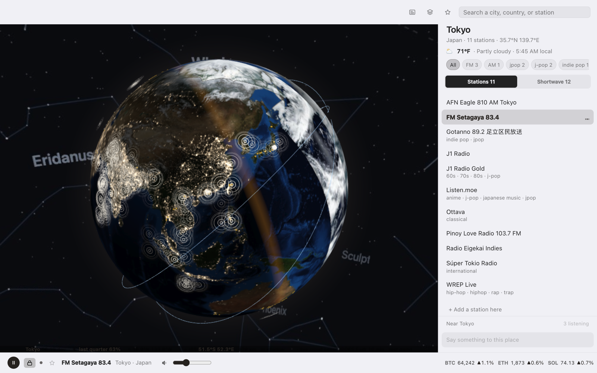
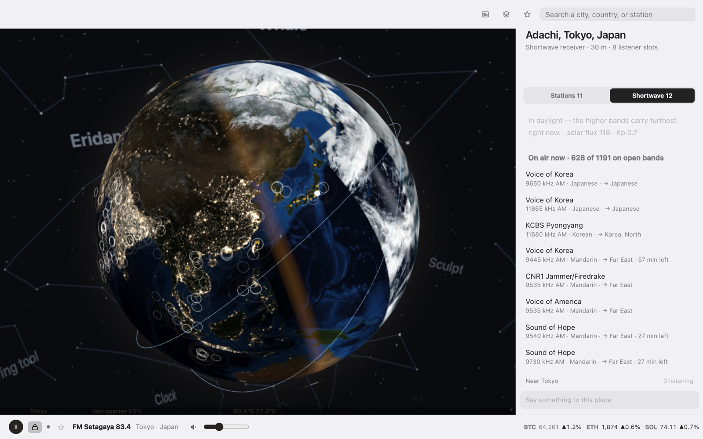
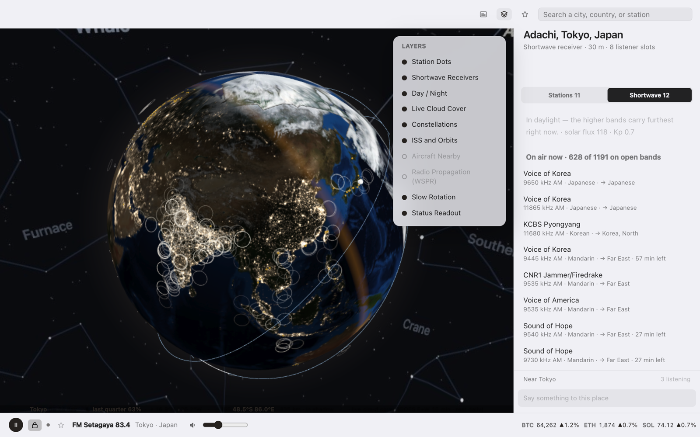

# AuralFM

**A window onto the world you can listen to.**

*Aural* — of or relating to the ear, and the sense of hearing.



Open it and the Earth is there — real weather moving across it, the day/night line
where it truly is, the ISS overhead, the actual planets behind. Click anywhere and
hear what that place is listening to right now.

**38,342 radio stations across 12,296 places in 227 countries, around 800
shortwave receivers you can borrow, and the ionosphere drawn over the top of it.**

The stations are streams. The shortwave receivers are somebody's actual antenna,
in somebody's actual garden, and the signal reaches it off the ionosphere with no
company anywhere in the middle. That is the one part of this that is not a CDN.

**Nothing in the middle.** A decentralized radio client: 38,342 stream endpoints,
837 independently operated receivers and 309 relays, none of them ours. There is
nothing to sign into, nothing reports back, and nobody keeps a list of what you
played.

*"No backend of our own" is retired as a slogan.* It was true and it was the wrong
thing to lead with — a claim about our infrastructure rather than about what the
app is for, and one that quietly ruled out anything needing a service later.
What is worth saying is that the network is somebody else's on purpose: every
transmitter, every receiver, every relay belongs to a person who is not us, and
that is the point rather than an economy.

Said precisely, because the precise version is the stronger one: the stations are
somebody's stream servers, so hearing audio needs a connection — true of every
radio app there is. What is unusual is that everything **around** the audio is
already on your machine. The catalogue is local, so search, browse and the globe
all work with the network unplugged.

Inspired by [radio.garden](https://radio.garden) — Jonathan Puckey's, and the
thing that kept pulling me back to Tokyo, Kenya, Iceland, South Africa. Started
because Apple is winding down radio support in Shortcuts and Apple Music.

```
┌────────────────────────────────┐
│  AuralFM                       │
│  ┌──────────────────────────┐  │
│  │  Search 38,342 stations  │  │
│  └──────────────────────────┘  │
│  Favorites                     │
│  1   KEXP 90.3 FM              │
│      Seattle WA · United St…   │
│  2   WWOZ FM 90.7              │
│      New Orleans LA · jazz…    │
│  ────────────────────────────  │
│  ⏸   WWOZ FM 90.7    ──●────   │
│      New Orleans LA            │
└────────────────────────────────┘
```

---

## Requirements

- macOS
- [Node.js](https://nodejs.org) 18+ (developed on 24)

## Install a build

There is no signed release yet — see [#4](https://github.com/meltonbell3/auralfm/issues/4).
Until there is, a downloaded DMG needs one deliberate step, because macOS
Gatekeeper refuses unsigned apps on first launch:

1. Download the DMG for your Mac from
   [Releases](https://github.com/meltonbell3/auralfm/releases) — `arm64` for Apple
   silicon, the unsuffixed one for Intel.
2. Drag **AuralFM** to Applications.
3. **Right-click the app → Open**, then confirm. A double-click will not work.

If macOS still refuses:

```bash
xattr -dr com.apple.quarantine /Applications/AuralFM.app
```

**Check what you downloaded.** An unsigned build has no other integrity signal, so
the checksums published with each release are it:

```bash
shasum -a 256 -c SHA256SUMS.txt
```

Releases are built on a Mac rather than in CI, and `npm run release` is the whole
pipeline — it gates on a clean tree and a green audit, builds both architectures,
verifies the station catalog and the licence notices are actually inside the
`app.asar`, writes checksums, and marks the release a prerelease while it is
unsigned. `--dry-run` does all of that and publishes nothing.

## Build it yourself

```bash
git clone https://github.com/meltonbell3/auralfm.git
cd auralfm
npm install
```

AuralFM's own stations are in the repo, in `data/catalogue.json`: every one
confirmed by radio-browser.info or by its own stream and website, placed in its
town from GeoNames. The bundle the app loads is generated from it, adding
radio-browser's other stations, genres and what each station says about itself.
GeoNames first (`data/geonames/`: cities1000, admin1CodesASCII, countryInfo, from
download.geonames.org), then:

```bash
npm run catalogue # data/catalogue.json + radio-browser -> data/stations.json + stations.min.json
npm run crawl:sdr # kiwisdr -> data/sdr.min.json, the receiver list
npm run icons     # rasterize assets/*.svg, and build build/icon.icns
npm start         # run it
```

`crawl:sdr` takes seconds — it is one request to an aggregate list, never to the
receivers themselves. `catalogue` is the slow one: the first run asks every
station about itself, which takes hours; later runs ask only the new ones.

The globe opens on launch. Close it and AuralFM keeps playing from the menu bar —
right-click the tray icon for **Open the Globe**, **About**, **Open at Login** and
**Quit**.

### Just trying it out?

`node scripts/base.mjs && node scripts/profiles.mjs` builds a playable catalogue
from the repo alone in under a minute, without genres from radio-browser. The
receiver bundle is committed, so shortwave works immediately either way.

## What it does



*Adachi, Tokyo — 628 of 1,191 scheduled broadcasts, on the bands that are open
right now. Note Sound of Hope on 9540 kHz and CNR1 Firedrake on 9535: a jammer
and its target, five kilohertz apart, both on the same list.*

### Listening

- **Any station in the world** — 38,342 channels across 12,296 places in 227 countries.
- **Around 800 shortwave receivers.** The count moves every week, because people
  plug a receiver in and take it down again. Click an amber dot and you are listening to a real
  antenna in Trondheim, or Christoval, or a Cold War coastal fortress in Sweden.
  Bands are ordered by whether that path is likely open right now, because
  shortwave propagation depends on whether the path is in daylight — and the globe
  already knows where the terminator is.
- **Real tuning, not band centres.** The shortwave list is the EiBi schedule —
  9,289 broadcasts a season, resolved to whatever is transmitting *this minute*
  in UTC, with the language and where it is beamed. Tuning "New Zealand" gets you
  RNZ Pacific on the frequency it is actually using this hour, not the middle of
  the 31 m band and a hiss. Ranked by whether the signal is pointed at that
  receiver, then by whether the band is open.
- **A waterfall.** The spectrum around what you are tuned to, so you can see the
  carrier, the neighbour 5 kHz away, and the fifteen-second stripes of FT8. It
  is what makes the filter width mean something.
- **Bandwidth and fine tuning.** AM at ±2000, ±3500 or ±4900 Hz; 100 Hz steps,
  10 Hz on sideband. The default clears the adjacent carrier — on a band where
  channels sit 5 kHz apart, a wider filter lets both neighbours in and their
  carriers beat into a whistle, which is the sound of a station that is *nearly*
  tuned.
- **31 bands**, including seven amateur bands, morse, and the digital modes —
  FT8, FT4, PSK31 and the WSPR beacons the propagation arcs are drawn from. We
  do not decode them; the point is that you can hear them, and a good evening on
  14.074 MHz is one of the strangest sounds on shortwave.
- **Aviation on HF.** Out over an ocean an aircraft is beyond VHF range and talks
  to the ground on shortwave. Tune *Shannon VOLMET* from Iceland and you hear the
  weather being read for transatlantic flights.
- **It tells you why a band is dead.** Bands are ordered by daylight, solar flux
  and geomagnetic activity — the operator's actual rule of thumb — and a closed
  band says which one it failed. *"solar flux 127 is too low for 28.4 MHz"* is a
  different thing from a greyed-out row that could just be broken.
- **Add a station AuralFM doesn't have.** The catalogue is a snapshot; your local
  station might not be in it. Add it, and it lives on your machine.
- **Search** by station, city, country, or genre. "jazz new orleans" works.
- **Favorites** with `1`–`9` hotkeys, and **Lock** to browse the world without
  changing what you're hearing.

### The globe

- **A real Earth in real space** — actual satellite imagery and a day/night
  terminator computed from the sun's true position.
- **City lights**, from NASA's Black Marble at 8192x4096. The night side is not
  a dark texture; it is where people are, down to individual towns along a
  motorway.
- **A named sky.** 5,044 catalogued stars and 89 constellations, labelled in
  whatever language the app is running — so it says *that is Orion* rather than
  drawing a shape and leaving you to guess.
- **The zodiac as the fact it is.** The ecliptic — the plane of the solar system
  seen edge-on from inside it — is drawn across the sky, and the twelve figures
  the Sun passes through are brightened against it. The planets sit visibly on
  that line, which is the explanation for both the zodiac and the word *planet*.
  Ophiuchus is drawn like any other figure and is not in the twelve, because the
  zodiac is twelve for Babylonian reasons rather than astronomical ones.
- **The five naked-eye planets**, where they actually are tonight.
- **Live cloud cover** — GOES geostationary imagery refreshed every 10 minutes over
  a daily global pass, so the weather on the globe is the weather that is up there.
- **The ISS and the Chinese space station**, live, named, with their ground tracks.
- **The ionosphere, drawn.** WSPR is a worldwide network of amateurs
  transmitting tiny beacons and reporting everything they hear, so every report
  is a statement that a signal left one grid square and arrived in another, just
  now. Drawn as arcs bowing off the surface — because that is what the signal
  did — with brightness following signal-to-noise. Rome to New Zealand is 18,512
  km and it is on the globe right now.
- **Other listeners and their messages**, if you switch it on — see below.
- **Live local conditions** — pick a place and see its weather and local time, so
  you know it is 53°F and overcast at 12:45 AM where the station is.
- **Somewhere it is the middle of the night.** Before you pick anything, the rail
  offers the places currently in the small hours — the overnight shows, the hours
  radio keeps to itself. Pick a town with one station and it offers the
  neighbours instead of a blank panel.

### The app

- **The globe is the app** — a standalone window, with a menu bar companion that
  keeps playing when the window is closed. It hides, it doesn't stop.
- **Seven colour schemes** — onyx and bone by default — five interface
  languages, an appearance override, an increased-contrast mode and adjustable
  dot sizes. A palette colours the things *around* the planet; the Earth is real
  satellite imagery and is never recoloured.
- **Now playing in the menu bar**, with media key support.

### Other listeners, and talking to them

Off by default, because it is the only thing in AuralFM that sends anything.

Switched on, and only while something is playing, it announces the **station's**
location — rounded to a four-character geohash, about 20 km — over public
[Nostr](https://nostr.com) relays, and offers a chat scoped to that cell. Other
listeners appear as slow pulsing rings on the globe.

- **Never your location.** The coordinates are the station's, the same rule the
  weather already follows.
- **No account.** The keypair is generated when the app opens and thrown away
  when it closes. A stable key would make you the same person across sessions.
- **No server of ours.** Relays are other people's and interchangeable.
- **Said precisely:** it uses an *ephemeral* event kind, which relays are asked
  not to retain. That is a SHOULD in the spec, not a MUST — testing found an
  announcement replayed after the fact — so the payload is built to be worthless
  if kept rather than relying on the promise.

- **Somebody else's convention, on purpose.** The first version used an event
  kind picked because nothing else used it, which is exactly why it was empty —
  a private room, correctly built, with nobody in it. It now speaks
  [bitchat](https://github.com/permissionlesstech/bitchat)'s geohash format,
  which is public domain and already has people using it. Every message we send
  carries their `teleport` tag, because the cell is always the *station's* and
  never the listener's: somebody in Houston listening to Rio appears in Rio's
  channel, and without that tag it would read as a claim to be standing there.
- **Relays are chosen by distance.** A conversation in Rio lives on the relays
  near Rio; three hardcoded servers saw 16 people where a geo-aware list saw 328.
  The directory is [georelays](https://github.com/permissionlesstech/georelays),
  MIT, 411 relays with coordinates.

Honest expectation: **inhabited, but quiet.** Hundreds announce presence; actual
conversation is thin. It is a room with people in it rather than an empty one,
which is a different and better problem.

## Keyboard

| Key | Action |
|---|---|
| `space` | Play / pause |
| `1`–`9` | Play that favorite |
| `esc` | Clear the search, or close the popover |
| `return` | Play the first search result |

## How it works

Our own catalogue, joined at build time with radio-browser and what each
station says about itself, so the app depends on none of them to browse.

```
BUILD TIME
  data/catalogue.json ── our stations ──┐  confirmed by radio-browser or by
   placed from GeoNames                  │  their own stream and website
                                         ├──> data/stations.min.json
  radio-browser ── more stations, genres ┤
  each station ── its stream, its site ──┘  (scripts/enrich.mjs)

  rx.kiwisdr.com ── receivers ────────> data/sdr.min.json      (98 KB)
   every listed shortwave site, all with GPS

RUN TIME
  Search + Explore read the local bundles.       (no network)

  Press play on a station -> its own server, found by:
    1. radio-browser, by the station's own id there
    2. the stream we recorded for it (its profile)
    3. last-known-good URL cached on disk
    4. radio-browser, matched on name + country
    0. a station you added yourself skips all of it — you gave us the URL

  Press play on a shortwave band -> connect straight to that receiver:
    ws://host/kiwi/<ts>/SND, IMA-ADPCM, decoded in the browser
```

No directory is queried while you browse, and a station with a stream of its
own recorded plays even when radio-browser is unreachable.

**Why our own catalogue?** It began in 2026 as a crawl of radio.garden. On 26
September it became AuralFM's own (scripts/own.mjs): a station stays only where
radio-browser or the station itself confirms it, every one has an AuralFM id,
and every town comes from GeoNames. Nothing in it is radio.garden's any more.

**Being a good API citizen.** radio-browser's docs ask clients to report each
play so their popularity ranking stays meaningful, so AuralFM calls
`/json/url/{uuid}` whenever a station starts (fire-and-forget — it can never
affect playback). It sends a descriptive `User-Agent`, and discovers mirrors via
`/json/servers` rather than pinning one host.

**Weather** comes from [Open-Meteo](https://open-meteo.com) — chosen because it
needs no API key, so a fresh clone has working weather with nothing to sign up
for. It is the one live thing in an otherwise offline-first app, so it is
strictly best-effort: cached for 10 minutes, and silent on failure. Only the
selected city's coordinates are sent, never the user's location.

**The live layers, and what each one costs somebody.**

```
  wspr.live        propagation arcs      one aggregated query / 3 min
  NOAA SWPC        solar flux, Kp        every 20 min
  Coinbase         crypto ticker         one WebSocket
  a KiwiSDR        shortwave audio       only when you click that receiver
  Nostr relays     other listeners       only if you switch presence on
```

Every one is free, most are run by volunteers, and none of them is load-bearing:
the globe, the catalogue and search work with all of it unreachable.

**Being a good guest.** Every live service here is free and most are run by
volunteers. Each one gets a contactable `User-Agent`, a cache, and an exponential
backoff on failure. That discipline is not decorative — AuralFM once retried a
failed Celestrak fetch every 30 seconds and got its IP blocked for a day, which
is why `src/backoff.js` exists and why `npm run audit` checks that every polled
service has a cooldown. The shortwave receivers get stricter rules again:
never auto-connect, one session at a time, never retry a refusal, never enumerate
them.

**Why a native app instead of a web page?** 47% of the most-played radio streams
are served over plain `http://`. A page served over HTTPS cannot play them —
mixed-content blocking kills them silently. A native shell has no such limit.



*Everything the globe draws, and what it costs. WSPR is dimmed because it is off
by default — it polls a volunteer service, so it is something you ask for rather
than something you have to notice and switch off.*

## Project layout

```
src/                     main process unless noted
  main.js                tray, windows, menus, deep links, start-up
  main/                  the Electron side of the main process
    ipc-*.js             IPC handlers, one module per area, registered by main.js
    store.js             the state file
  preload.js             the entire renderer API surface (context-isolated)
  prefs.js               preference defaults, and what a write may contain
  catalog.js             bundle loading + ranked search
  resolver.js            3-tier stream URL resolution
  failures.js            reliably dead streams stop being offered first
  safehost.js            vets hosts a list chose before connecting to them
  useragent.js           how the app identifies itself to every server
  backoff.js             shared failure cooldown for polled services
  weather.js             current conditions via Open-Meteo
  clouds.js              near-real-time satellite cloud imagery
  iss.js                 live ISS position
  satellites.js          orbiting objects and their paths
  space.js               solar flux and geomagnetic activity
  wspr.js                propagation reports -> arcs
  sdr.js                 shortwave receiver list
  schedule.js            what is on shortwave right now (EiBi)
  news.js                local headlines
  markets.js             market ticker
  geo.js                 great-circle distance
  presence-nostr.js      optional presence and chat over Nostr, no server
  nostr-private.js       private messages (bitchat envelope format)
  hub.js                 private rooms: a name and a password
  identity.js            optional durable identity, off by default
  social.js              favorites and verified people
  muted.js               people you have chosen not to hear from
  safety.js              the safety tools, and their limits
  mystations.js          stations you added yourself
  docs.js                privacy/terms/licences, allowlisted
  tips.js                rule-based tips
  palettes.js            colour schemes
  i18n.js                interface strings, 5 languages
  renderer/              (renderer process)
    popover.html/.js     menu bar player — the only thing that makes sound
    explore.html         the globe, chat, headlines, markets
    explore-*.js         Explore, in parts that share one scope; each part's
                         wiring runs from explore.js once every part has loaded
    explore.js           wiring and boot
    settings.html/.js    appearance, colour, language, your stations
    splash.html/.js      launch mark
    kiwi.js              KiwiSDR protocol + IMA-ADPCM decoder
    astro.js             planetary positions (JPL elements)
    card.js              the share card
    tour.js, tips.js,
    tipcard.js           introduction, help tags, tips
    icons.js             the icon set
    reveal.js            show the page once it is on screen
    errors.js            renderer error capture
scripts/
  audit.mjs              the test suite (npm run audit)
  base.mjs               data/catalogue.json <-> data/stations.json
  own.mjs                the one-time move to a catalogue of our own (26 Sept 2026)
  tags.mjs               radio-browser: genre tags, ids -> bundle
  expand.mjs             radio-browser's other stations -> bundle
  enrich.mjs             what each station says about itself (stream, website)
  profiles.mjs           station profiles and the stream each plays from
  crawl-sdr.mjs          kiwisdr -> receiver bundle
  fetch-schedule.mjs     EiBi shortwave schedule
  relays.mjs             geo-located Nostr relay directory
  sky.mjs, lights.mjs    star bundle, city-lights texture
  vendor.mjs             copies runtime libraries into renderer/vendor
  notices.mjs            generates THIRD-PARTY-NOTICES.md
  make-icons.js          SVG -> PNG via Electron (keeps alpha)
  release.mjs            gate, build, verify, publish
  sync-kb.mjs            mirrors docs into the knowledge-base vault
  relay-test/            manual two-party tests against live relays
assets/                  source icons, fonts, licences, attribution
data/                    receivers, schedule, relays, word filter, our own
                         stations (catalogue.json) and their ids (ids.json) are
                         tracked; the station bundle is generated (gitignored)
docs/                    privacy, terms, receivers, legal and security
```

## Scripts

| Command | What it does |
|---|---|
| `npm start` | Run the app |
| `npm run catalogue` | Build the station bundle from `data/catalogue.json` and radio-browser (resumable) |
| `npm run tags` | Join radio-browser genre tags onto the catalog |
| `npm run icons` | Regenerate PNGs from `assets/*.svg` |
| `npm run crawl:sdr` | Refresh the shortwave receiver list |
| `npm run schedule` | Rebuild the EiBi shortwave broadcast schedule (seasonal) |
| `npm run relays` | Rebuild the geo-located Nostr relay directory |
| `npm run sky` | Rebuild the star, constellation and name bundle |
| `npm run lights` | Fetch NASA Black Marble and build the city-lights texture |
| `npm run audit` | Pre-flight checks for the traps this codebase has fallen into |
| `npm run release` | Gate, build both arches, verify the artifacts, publish. `--dry-run` to rehearse |
| `npm run test:relays` | Two independent clients meet over live relays and exercise presence, chat, notes, private messages and mutual favorites. **Manual only — never CI**, it publishes to other people's relays |
| `npm run test:app-inbound` | Drives real inbound traffic from a second client into the running app and asserts against its DOM. **Manual only** — see the header for the setup |

## Known limits

- **Moonlight isn't modelled.** The terminator follows the real sun. The moon's
  position and phase are computed and shown, but the Earth is not lit by it —
  real moonlight is ~400,000× dimmer than sunlight and would be invisible next to
  the night-lights texture.
- **66% of stations have no genre tags.** A genre query only finds a station if
  radio-browser knew it *and* the two directories could be matched confidently.
  Aggressive matching would raise coverage by putting wrong genres on real
  stations, which isn't a trade worth making.
- **Some stations block browser playback.** SomaFM, for one, serves curl happily
  but returns 403 to anything sending a browser `Origin`. Expect roughly 5% of
  streams to be dead or blocked at any given time.
- **The catalog is a snapshot, not a subscription.** Stations come and go; re-run
  `npm run catalogue` every few months.
- **Unsigned.** Gatekeeper will complain until the app is signed and notarised.
- **The interface is mid-rework.** This began as a menu-bar player and became a
  standalone app with a globe, a receiver, a spectrum display and a chat. Each
  addition was reasonable; the accumulation was not. The dial has moved out of
  the popover and the ticker and prices out of the transport bar — see
  [#29](https://github.com/meltonbell3/auralfm/issues/29) and
  the interface notes in the vault for what is left: rail structure, and
  a layer inspector before the next map layer lands rather than after.
- **No spam defence in chat.** We share a public channel with anyone. bitchat
  uses optional proof-of-work; we implement none. Fine at this traffic,
  embarrassing at ten times it.
- **Live captions do not keep up on older hardware.** Whisper runs entirely on
  your machine — there is no cloud speech API, because sending the audio
  somewhere would mean the app transmits what you are listening to. The cost is
  speed. Measured on an Intel i5-8257U, single-threaded WebAssembly: `whisper-base`
  takes **39.6 seconds** to transcribe six seconds of audio (RTF 6.61), and
  `whisper-tiny` **15.5 seconds** (RTF 2.59). Anything above 1.0 cannot keep up.
  WASM threads would help and are unavailable — `SharedArrayBuffer` needs
  cross-origin isolation, which a `file://` page cannot have. The feature is off
  by default and the plumbing is complete; it wants Apple Silicon, a custom
  protocol with COOP/COEP headers, or native whisper.cpp. See
  [#30](https://github.com/meltonbell3/auralfm/issues/30).
- **Shortwave receivers are volunteers' machines.** AuralFM connects only when you
  click one, one at a time, never retries a refusal, and never scans them. If a
  receiver is busy, that is a person's hardware being used by somebody else.
- **Presence is an empty room.** It works — verified between two instances across
  three relays — but nobody else is running AuralFM yet, and geotagged Nostr
  traffic generally is thin. It seeds a convention rather than joining one.
- **Propagation arcs are the loudest paths, not all of them.** Around 30,000 WSPR
  spots arrive every ten minutes; the globe draws the 260 longest, because the
  short domestic hops would be specks and the long paths are the ones saying
  something about the ionosphere.
- **The band outlook is a rule of thumb, not a propagation model.** It answers
  "is this worth tuning", not "will this specific path open".
- **Stocks are dormant.** There is no keyless real-time equity source — Yahoo,
  Stooq and CNBC were all re-probed and all refuse. Crypto is genuinely live over
  Coinbase's keyless feed; equities light up only if you set `AURALFM_STOCK_KEY`.

## Siri and Shortcuts

AuralFM registers an `auralfm://` URL scheme, so any Shortcut that opens a URL can
drive it — which is how you get "Hey Siri, play KEXP" back.

| URL | Does |
|---|---|
| `auralfm://play?station=KEXP` | Play the best match for a station name |
| `auralfm://play?place=Reykjavik` | Play the top station in a place |
| `auralfm://pause` | Pause / resume |
| `auralfm://next` | Next favorite |
| `auralfm://open` | Open the popover |

**Making a Shortcut:** Shortcuts → new shortcut → *Open URLs* → paste one of the
above → name it "Play KEXP". Saying that name to Siri now runs it.

Station and place names are matched with the same ranking the in-app search uses,
so "kexp", "wwoz" and "new orleans" all work without being exact.
## Credits

- Stations: [radio-browser.info](https://www.radio-browser.info) (public domain),
  and the stations themselves
- Towns and regions: [GeoNames](https://www.geonames.org) (CC BY 4.0)
- Shortwave receivers: the [KiwiSDR](http://kiwisdr.com) community, and the
  operators who pay for the bandwidth
- Orbital elements: [CelesTrak](https://celestrak.org) and [SatNOGS](https://db.satnogs.org)
- Propagation reports: [wspr.live](https://wspr.live), and the amateurs whose
  beacons and receivers make the data exist at all
- Space weather: [NOAA SWPC](https://www.swpc.noaa.gov)
- Crypto prices: [Coinbase](https://www.coinbase.com)
- Satellite imagery: [NASA GIBS](https://nasa-gibs.github.io/gibs-api-docs/) (VIIRS true colour)
- Station genres and fallback streams: [radio-browser.info](https://www.radio-browser.info)
- Globe icons by **emilegraphics** via [the Noun Project](https://thenounproject.com) —
  two royalty-free licences purchased 4 August 2026, certificates in
  `assets/licenses/`; see [`assets/ATTRIBUTION.md`](assets/ATTRIBUTION.md)

Full licence texts for every library this app ships, vendors or downloads are in
[`THIRD-PARTY-NOTICES.md`](THIRD-PARTY-NOTICES.md), regenerated on every build.

Personal project, not affiliated with or endorsed by any of the above.

