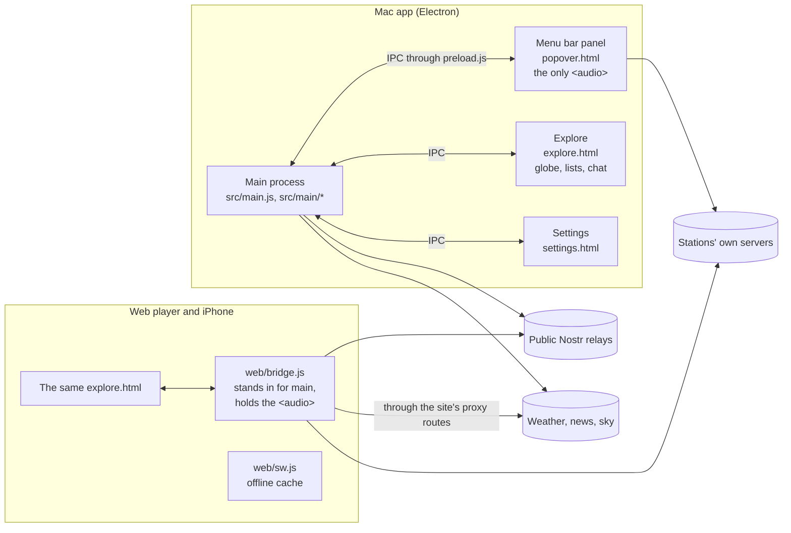

# How AuralFM is built

One set of pages, run two ways: inside Electron as the Mac app, and in a
browser as the web player (which is also the iPhone app, added to the Home
Screen). There is no server of ours behind either.

## The shape

## The bridge

**The pages talk to `window.auralfm` and to nothing else.**

- On the Mac, `src/preload.js` defines `window.auralfm`. Each method is one IPC
  call to the main process. The pages run with context isolation and no Node.
- On the web, `web/bridge.js` defines the same object. Where the main process
  used a module that only needs `fetch` (the catalogue, weather, prices, the
  strings), the bridge calls that very module. Nothing is written twice.

So `src/renderer/` is the app on every surface, and a feature added there
arrives on the Mac, the web and the phone at once. `src/preload.js` is the list
of everything a page can ask for; the audit fails if a method there has no
handler.

## Who makes sound

Exactly one thing. On the Mac it is the menu bar panel (`popover.js`), which
stays alive when every window is closed. On the web it is the bridge. Explore
never plays anything: it sends `transport` and `tune`, and paints the state
the player publishes. The sleep timer (`sleep.js`) lives with the player for
the same reason.

## The folders

| Folder | What is in it |
|---|---|
| `src/main.js`, `src/main/` | The main process: windows, the tray, and the IPC handlers, grouped by subject (`ipc-player.js`, `ipc-chat.js`, and so on). `store.js` is what is saved. |
| `src/*.js` | Modules with no window: the catalogue (`catalog.js`), messaging (`presence-nostr.js`, `nostr-private.js`), headlines, weather, satellites, preferences, strings. Most run in the browser too. |
| `src/renderer/` | The pages. `explore.html` holds the markup and the whole stylesheet; `explore-*.js` are plain scripts that share one scope, loaded in the order the page lists them. |
| `web/` | What a browser needs on top: the bridge, the service worker, the phone layout (`web.css`), the sheets and the tab bar. |
| `scripts/` | Builds (`build-web.mjs`), the audit (`audit.mjs`), the capture script, and small tools. |
| `data/` | The built station list and profiles (not in git; `npm run catalogue` brings them), the shortwave schedule, the relay list. |
| `docs/` | This page, and the public documents the app and the site show. |

## Where the data comes from

- **Stations.** Built in another repository, `AuralFM/catalogue`, from the
  stations themselves, radio-browser.info and GeoNames. This repo carries
  copies of the three files it runs and of the built list.
- **Sound.** From each station's own server, straight to the listener.
- **Chat and presence.** Public Nostr relays. A new key for each place and each
  session, never saved, unless the listener turns on a lasting identity.
- **Everything saved.** On the device: a JSON file on the Mac, `localStorage`
  on the web. There is no account.

## The sites

auralfm.xyz, the Journal and the docs site are a third repository,
`AuralFM/site`. They read this one for the legal text and the catalogue.

## Tests

`npm run audit` is the test suite. It reads the source, loads the modules that
can run in Node, and checks what has broken before: an IPC method with no
handler, a colour off the palette, a licence that crept in. Every check was
written after a bug and seen to fail with that bug put back. There is no unit
test runner. The same command runs on every push (`.github/workflows/audit.yml`).

Checks that need a device or a person (a real iPhone, VoiceOver, a
keyboard-only pass) are tracked as issues labelled `device test`.
